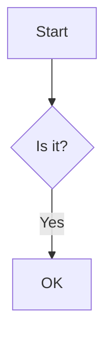

# Code

Inline `let x = 1;` and a backtick: `` a`b ``.

```rust
/// Adds two numbers.
fn add(a: i32, b: i32) -> i32 {
    a + b // "quoted" #hash $dollar
}
```

```python
def greet(name: str) -> str:
	return f"Hello, {name}!"  # tab-indented
```

```
plain fence without a language
    keeps    its    spacing
```

    indented code block
    second line

```json
{"key": [1, 2, 3], "nested": {"ok": true}}
```



```text
A very long line that should wrap inside the code block rather than overflow the page margin because nobody likes clipped code samples in a PDF.
```
