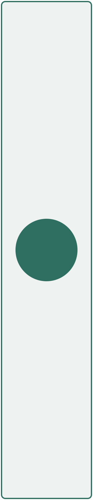

# Stress test: layout edge cases

A long unbroken URL in running text: https://example.com/a/very/long/path/that/keeps/going/and/going/without/any/spaces/at/all/index.html?query=parameter&another=value

A long identifier: `SomeExtremelyLongTypeNameThatDoesNotFitOnASingleLineInAnyReasonableLayoutWhatsoever`.

```text
a_single_code_line_without_any_spaces_that_is_far_too_long_for_the_page_width_and_must_not_overflow_the_margin
```

## Heading with `code`, *emphasis* and a [link](https://example.com)

| Column one | Column two | Column three | Column four | Column five | Column six | Column seven | Column eight |
|---|---|---|---|---|---|---|---|
| Long text that needs to wrap inside a narrow column | 2 | 3 | 4 | 5 | 6 | 7 | 8 |
| a | Supercalifragilisticexpialidocious | c | d | e | f | g | h |
| Footnote in a cell[^cell] | | | | | | | |

[^cell]: Footnotes work inside tables too.

- Level 1
  - Level 2
    - Level 3
      - Level 4
        - Level 5
          - Level 6

> A quote containing code:
>
> ```rust
> let quoted = true;
> ```
>
> | and | a table |
> |-----|---------|
> | 1   | 2       |

> [!NOTE]
> A callout with a code block:
>
> ```sh
> cargo test
> ```

- [ ] A task with two paragraphs.

  The second paragraph of the task.
- [x] A finished task

A very tall image is scaled to fit the page:



Trailing paragraph after the tall image.
