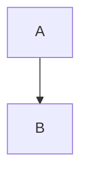

# Extensions

> [!NOTE]
> Notes stand out.

> [!WARNING]
> Careful.

Inline math $e^{i\pi} + 1 = 0$ and display:

$$
\int_0^1 x^2 \, dx
$$

==highlighted== text and a [[Wiki Page|wiki link]].

More

Hidden *content*.

Clickable?

